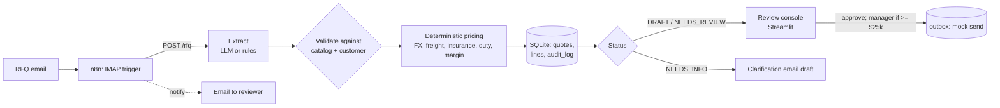

# Quotation Engine: RFQ email to approved quote, with a human in the loop

A working prototype of an automated quotation workflow for an import/export business: a customer RFQ email comes in, the system extracts the request, builds a **landed-cost** quote deterministically, flags anything risky, and queues it for human approval. Nothing is sent until a person approves it.

> **Everything in this repo is synthetic** (fictional company, suppliers, customers, price lists, 24 months of generated quote history). Duty rates are illustrative, not a real tariff schedule. "Sending" writes to an `outbox` table; no real email is ever sent.

## The problem

Quoting for imported goods is slow and error-prone. Someone reads an email, finds each SKU, converts supplier currency, works out freight (LCL minimums, CBM allocation), insurance and duty for the requested Incoterm, applies a customer-tier margin, and types it all into an email. Prep time scales with the number of lines, so it grows with volume (see `sql/reporting_query.sql`). The automated version does the reading and arithmetic in seconds and spends human attention only on decisions: approve, fix, or ask the customer.

## Architecture

## What's in this repo

| Path | What it does |
|---|---|
| `engine/pricing.py` | Pure, deterministic landed-cost math (FOB / CIF / DDP). **No LLM here, by design.** |
| `engine/extract.py` | Email to structured RFQ. Claude API when `ANTHROPIC_API_KEY` is set, regex rules otherwise. LLM output is validated, never trusted. |
| `engine/pipeline.py` | Validation flags, status routing, approval controls, audit log, clarification emails |
| `api.py` | FastAPI endpoints (`/rfq`, `/quotes/{id}`, `/quotes/{id}/approve`) so n8n can call the engine |
| `app.py` | Streamlit review console: queue, flags, email preview, approve / request info / reject, audit trail, impact estimate |
| `workflow/n8n_quotation_workflow.json` | Importable n8n workflow: IMAP trigger, API call, branch on status, notify humans |
| `sql/schema.sql`, `sql/seed_data.sql` | Schema (reference, history, workflow tables) and generated seed data |
| `sql/reporting_query.sql` | CTE + window-function analysis of quote-prep time vs volume, and customer ranking |
| `scripts/generate_seed.py` | Deterministic seed generator (688 history quotes, 20 SKUs, 8 sample RFQs) |
| `tests/` | 16 tests: hand-calculated prices, extraction edge cases, routing, approval controls, audit trail |

## How the 8 sample RFQs are routed

| RFQ | Scenario | Result |
|---|---|---|
| 01, 08 | Clean CIF / FOB requests | `DRAFT`, ready for one-click approval |
| 02 | $59k DDP order | `NEEDS_REVIEW` + `HIGH_VALUE`; only a manager can approve |
| 03 | 10 units where MOQ is 50 | `NEEDS_REVIEW` + `BELOW_MOQ` |
| 04 | Unknown SKU | `NEEDS_INFO`, cannot be approved; clarification email drafted |
| 05 | Missing quantity | `NEEDS_INFO` (the engine never guesses quantities) |
| 06 | Unknown customer | `NEEDS_INFO` |
| 07 | Free text, no SKU codes | `NEEDS_INFO` with rules mode; this is the case LLM mode is meant to help with |

## What this demonstrates

- **Process analysis to requirements:** the flag taxonomy and routing rules encode where a human is genuinely needed.
- **Quotation automation:** extraction, landed-cost pricing, draft email, review and approval steps.
- **Knowing when not to use AI:** the LLM reads messy text; arithmetic, validation and routing are plain code, and the LLM path falls back to rules on failure.
- **Controls:** approval gate, manager threshold, immutable audit log, "never guess a quantity".
- **Integration:** REST API + importable n8n workflow, SQL schema, reporting query.
- **Testing and documentation:** hand-computed expected values, `docs/setup.md`.

## Tech stack

Python 3.10+, SQLite, FastAPI, Streamlit, n8n, Anthropic API (optional), pytest.

## Honesty notes

- SQLite stands in for a production database or ERP; the integration pattern is the same.
- The LLM extraction path is covered by parsing tests only. The live API call is not part of the automated tests.
- The "Impact" tab estimates time saved from synthetic history plus a review-time assumption you set. It is not a measured result.
- Run it yourself (see `docs/setup.md`); quote your own numbers, not mine.
